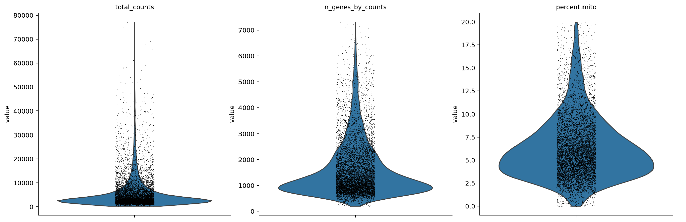
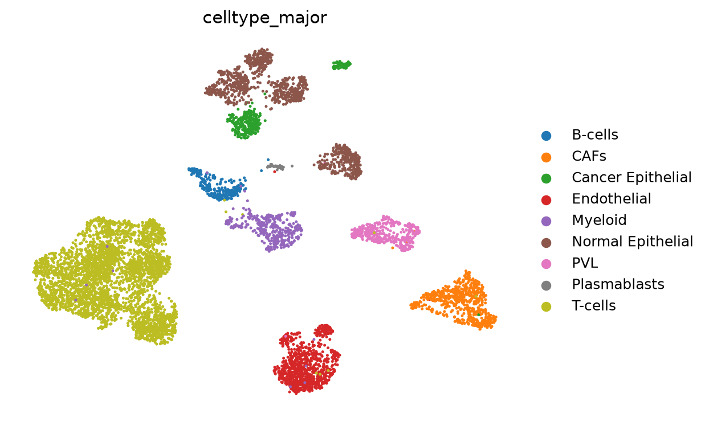
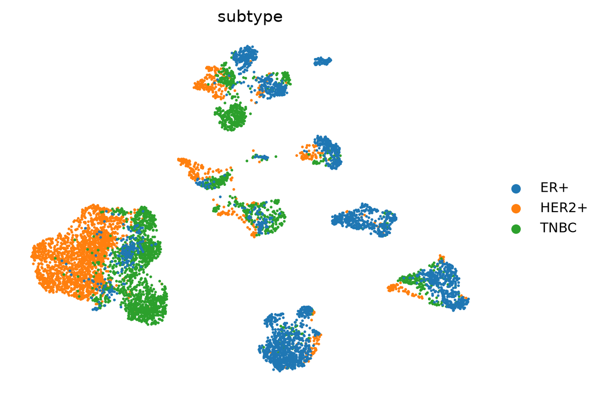
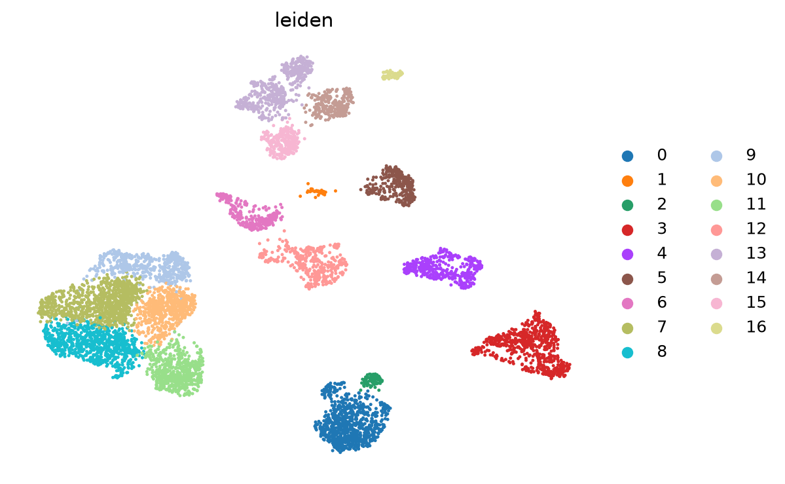
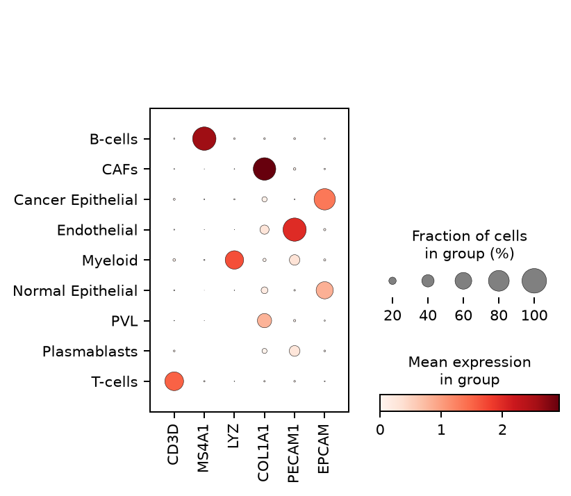
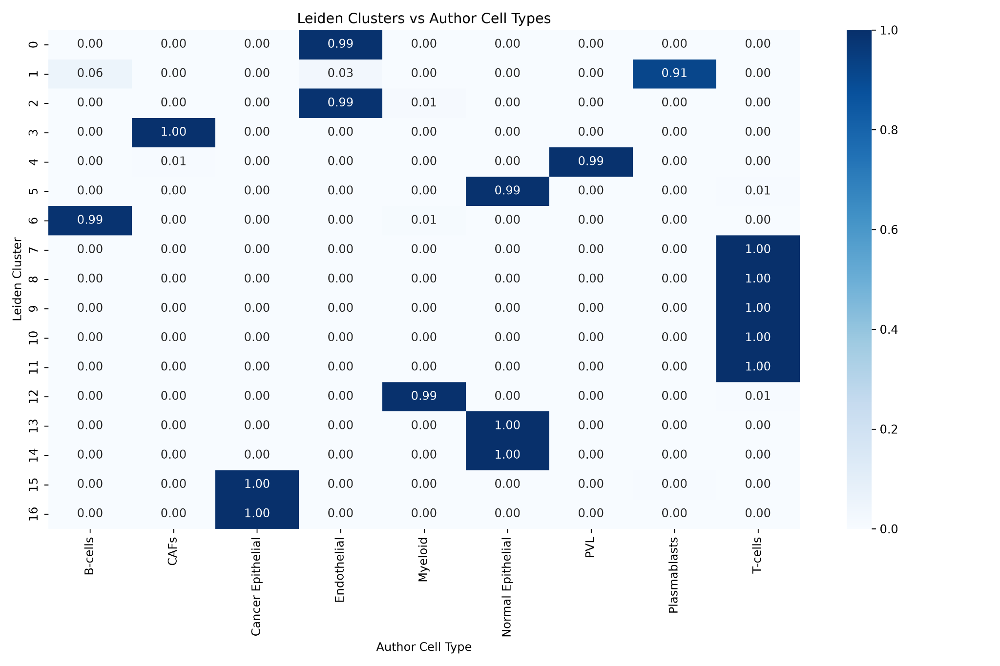
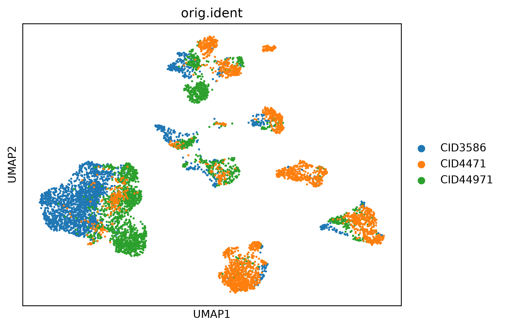
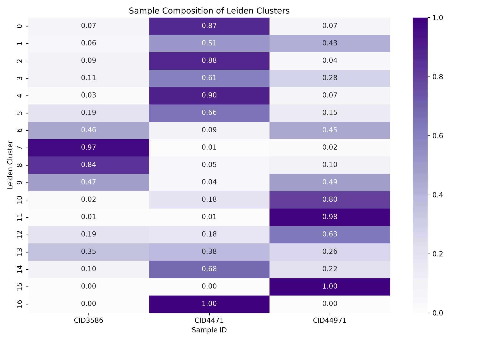

# Breast Cancer Single-Cell Atlas — Scanpy Pilot Reanalysis

  

## Project summary

This repository presents an **independent, Python/Scanpy-based pilot reanalysis** of the publicly available processed single-cell RNA-sequencing data from **Wu et al. (2021), *A single-cell and spatially resolved atlas of human breast cancers*** ([GEO GSE176078](https://www.ncbi.nlm.nih.gov/geo/query/acc.cgi?acc=GSE176078)).

**Research question:** Can a lightweight Scanpy workflow recover major breast tumor microenvironment cell populations, and what additional transcriptional and sample-associated structure appears under unsupervised clustering?

The pilot selects **up to 2,500 cells from each of three specimens**, one per ER+, HER2+, and triple-negative breast cancer (TNBC) category, to support analysis on a 16 GB RAM computer. This is **not a full reproduction** of the authors' computational workflow or study cohort.

## Key findings

- Major cell populations are clearly distinguishable in the UMAP embedding, and canonical marker expression broadly supports the published annotations.
- Leiden clustering identified **17 clusters**, most dominated by a single published major cell-type category.
- Several broad cell types, including T cells and epithelial cells, were subdivided into multiple Leiden clusters; these subdivisions are **not yet independently validated functional states**.
- Some clusters are strongly associated with individual specimens. With **one specimen per subtype**, patient and subtype effects are confounded; technical batch effects cannot be isolated from these figures.

## Results and figures

### 1. Quality control


**Figure 1.** Distributions of total UMI counts, detected genes per cell, and mitochondrial transcript percentage.

### 2. Major cell populations


**Figure 2.** UMAP colored by the nine major cell-type annotations supplied with the published dataset.

### 3. Breast cancer subtype labels


**Figure 3.** UMAP colored by the specimen-associated ER+, HER2+, or TNBC label. Subtype and patient identity are confounded in this pilot.

### 4. Unsupervised Leiden clustering


**Figure 4.** UMAP showing 17 Leiden clusters.

### 5. Canonical marker expression


**Figure 5.** Expression of CD3D, MS4A1, LYZ, COL1A1, PECAM1, and EPCAM across published major cell-type annotations.

### 6. Cluster–annotation concordance


**Figure 6.** Row-normalized fraction of each Leiden cluster assigned to each published major cell type. These values quantify **agreement with provided labels**, not independent annotation accuracy.

### 7. Sample-associated embedding structure


**Figure 7.** UMAP colored by specimen identifier (`orig.ident`).

### 8. Sample composition by Leiden cluster


**Figure 8.** Row-normalized sample composition within each Leiden cluster. Several clusters are strongly specimen-enriched.

For detailed legends, see [FIGURE_LEGENDS.md](FIGURE_LEGENDS.md).

## Analysis workflow

1. Inspect processed matrix dimensions and metadata (`01_inspect_data.py`).
2. Select a small, balanced-by-sampling-cap pilot subset and stream the sparse Matrix Market file without densifying the full dataset (`02_build_subset.py`).
3. Apply exploratory QC, normalization, highly variable gene selection, PCA, neighborhood graph construction, UMAP, and Leiden clustering (`03_scanpy_analysis.py`).
4. Generate a pilot summary report (`04_make_report.py`).
5. Compare Leiden clusters against published annotations and sample identifiers (`05_validate_clusters.py`).

**Note:** Published cell-type labels are used as reference annotations. This analysis starts from published processed counts and does not reproduce FASTQ processing or the original Seurat integration pipeline.

## Reproduce the analysis

Tested workflow targets a **16 GB RAM Mac**. Use a compatible Python environment (Python 3.10–3.12 recommended for this pilot).

```bash
python3 -m venv .venv
source .venv/bin/activate
python -m pip install -r requirements.txt
```

Download the processed files from [GSE176078](https://www.ncbi.nlm.nih.gov/geo/query/acc.cgi?acc=GSE176078) and place these files in `~/Downloads/Wu_etal_2021_BRCA_scRNASeq/`:

```text
count_matrix_sparse.mtx
count_matrix_barcodes.tsv
count_matrix_genes.tsv
metadata.csv
```

Run from the repository root:

```bash
python scripts/01_inspect_data.py
python scripts/02_build_subset.py
python scripts/03_scanpy_analysis.py
python scripts/04_make_report.py
python scripts/05_validate_clusters.py
```

Generated analysis files are written to the input data directory under `analysis/`, rather than committed to this repository. The full raw count matrix and `.h5ad` files are intentionally excluded from version control.

## Limitations

- Three selected specimens only, with one specimen per clinical subtype; **no valid subtype-level population inference** can be made.
- Sampling up to 2,500 cells per specimen does not preserve original cohort-level cell-type frequencies.
- QC thresholds are exploratory; no dedicated doublet-detection or comprehensive ambient-RNA correction is included.
- No sample integration/batch correction is performed in this pilot.
- Cluster labels are not equivalent to independently validated cell states.
- Concordance with author annotations is descriptive, not independent ground-truth validation.

## Planned extension

A follow-up macrophage-specific analysis will extract all author-annotated macrophages from the complete processed dataset, recluster them, investigate marker and functional signatures, and examine variation across **multiple independent patient samples**. This extension is planned and **not included** in the current results.

## Data, attribution, and references

- **Wu et al. (2021).** *A single-cell and spatially resolved atlas of human breast cancers*. Nature Genetics. [Article](https://www.nature.com/articles/s41588-021-00911-1)
- **Public dataset:** [GEO GSE176078](https://www.ncbi.nlm.nih.gov/geo/query/acc.cgi?acc=GSE176078)
- **Authors' original code:** [Swarbricklab-code/BrCa_cell_atlas](https://github.com/Swarbricklab-code/BrCa_cell_atlas)

This repository contains an independent educational/research reanalysis and is **not affiliated with or endorsed by the original authors**. Original data and annotations are credited to Wu et al.
